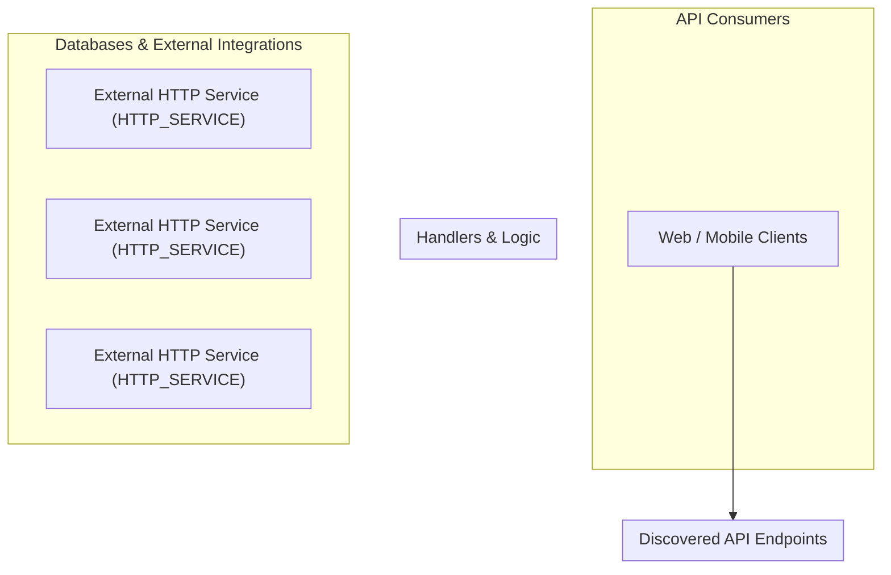

# Dependency Guardian — Repository Integration Map

Visual relationship map and matrix linking endpoints, handlers, internal dependencies, databases, and external third-party services.

## 1. System Architecture and Integration Diagram

---

## 2. End-to-End Relationship Matrix

| Route & Method | Handler Function | Source Location | Direct Dependencies | Storage / External Targets | Side Effects |
|---|---|---|---|---|---|

---

## 3. Outbound Network Boundaries

> [!IMPORTANT]
> All external outbound connections originating from this repository are inventoried below.

| Integration Name | Target Endpoint / Host | Integration Type | Initiating Source File | Redacted Credentials |
|---|---|---|---|:---:|
| **External HTTP Service** | `{base_url}/users/{user_id}` | `http_service` | `src/services/user_service.py:8` | 0 (Safe) |
| **External HTTP Service** | `{base_url}/payments/{payment_id}` | `http_service` | `src/services/payment_service.py:8` | 0 (Safe) |
| **External HTTP Service** | `{base_url}/search` | `http_service` | `src/services/search_service.py:8` | 0 (Safe) |
