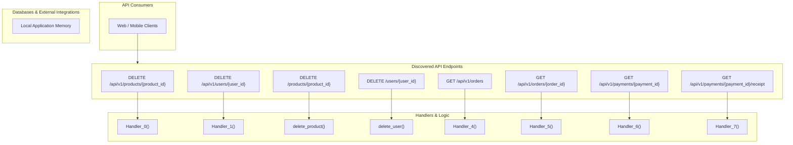

# Dependency Guardian — Repository Integration Map

Visual relationship map and matrix linking endpoints, handlers, internal dependencies, databases, and external third-party services.

## 1. System Architecture and Integration Diagram

---

## 2. End-to-End Relationship Matrix

| Route & Method | Handler Function | Source Location | Direct Dependencies | Storage / External Targets | Side Effects |
|---|---|---|---|---|---|
| `DELETE /api/v1/products/{product_id}` | *N/A* | `sample-api/contracts/openapi-v1.json:None` | *None* | *In-memory / Read-only* | None detected |
| `DELETE /api/v1/users/{user_id}` | *N/A* | `sample-api/contracts/openapi-v1.json:None` | *None* | *In-memory / Read-only* | None detected |
| `DELETE /products/{product_id}` | `delete_product()` | `sample-api/versions/v1/app/api/products.py:53` | *None* | *In-memory / Read-only* | None detected |
| `DELETE /users/{user_id}` | `delete_user()` | `sample-api/versions/v2/app/api/users.py:54` | *None* | *In-memory / Read-only* | None detected |
| `GET /api/v1/orders` | *N/A* | `sample-api/contracts/openapi-v1.json:None` | *None* | *In-memory / Read-only* | None detected |
| `GET /api/v1/orders/{order_id}` | *N/A* | `sample-api/contracts/openapi-v1.json:None` | *None* | *In-memory / Read-only* | None detected |
| `GET /api/v1/payments/{payment_id}` | *N/A* | `sample-api/contracts/openapi-v1.json:None` | *None* | *In-memory / Read-only* | None detected |
| `GET /api/v1/payments/{payment_id}/receipt` | *N/A* | `sample-api/contracts/openapi-v1.json:None` | *None* | *In-memory / Read-only* | None detected |
| `GET /api/v1/products` | *N/A* | `sample-api/contracts/openapi-v1.json:None` | *None* | *In-memory / Read-only* | None detected |
| `GET /api/v1/products/{product_id}` | *N/A* | `sample-api/contracts/openapi-v1.json:None` | *None* | *In-memory / Read-only* | None detected |
| `GET /api/v1/users` | *N/A* | `sample-api/contracts/openapi-v1.json:None` | *None* | *In-memory / Read-only* | None detected |
| `GET /api/v1/users/{user_id}` | *N/A* | `sample-api/contracts/openapi-v1.json:None` | *None* | *In-memory / Read-only* | None detected |
| `GET /health` | *N/A* | `sample-api/contracts/openapi-v1.json:None` | *None* | *In-memory / Read-only* | None detected |
| `GET /orders` | `list_orders()` | `sample-api/versions/v2/app/api/orders.py:17` | *None* | *In-memory / Read-only* | None detected |
| `GET /orders/{order_id}` | `get_order()` | `sample-api/versions/v2/app/api/orders.py:34` | *None* | *In-memory / Read-only* | None detected |
| `GET /payments/{payment_id}` | `get_payment()` | `sample-api/versions/v2/app/api/payments.py:24` | *None* | *In-memory / Read-only* | None detected |
| `GET /payments/{payment_id}/receipt` | `get_payment_receipt()` | `sample-api/versions/v1/app/api/payments.py:32` | *None* | *In-memory / Read-only* | None detected |
| `GET /products` | `list_products()` | `sample-api/versions/v2/app/api/products.py:17` | *None* | *In-memory / Read-only* | None detected |
| `GET /products/{product_id}` | `get_product()` | `sample-api/versions/v2/app/api/products.py:39` | *None* | *In-memory / Read-only* | None detected |
| `GET /users` | `list_users()` | `sample-api/versions/v2/app/api/users.py:17` | *None* | *In-memory / Read-only* | None detected |
| `GET /users/{user_id}` | `get_user()` | `sample-api/versions/v2/app/api/users.py:37` | *None* | *In-memory / Read-only* | None detected |
| `PATCH /api/v1/orders/{order_id}/status` | *N/A* | `sample-api/contracts/openapi-v1.json:None` | *None* | *In-memory / Read-only* | None detected |
| `PATCH /orders/{order_id}/status` | `update_order_status()` | `sample-api/versions/v2/app/api/orders.py:42` | *None* | *In-memory / Read-only* | None detected |
| `POST /api/v1/orders` | *N/A* | `sample-api/contracts/openapi-v1.json:None` | *None* | *In-memory / Read-only* | None detected |
| `POST /api/v1/payments` | *N/A* | `sample-api/contracts/openapi-v1.json:None` | *None* | *In-memory / Read-only* | None detected |
| `POST /api/v1/products` | *N/A* | `sample-api/contracts/openapi-v1.json:None` | *None* | *In-memory / Read-only* | None detected |
| `POST /api/v1/users` | *N/A* | `sample-api/contracts/openapi-v1.json:None` | *None* | *In-memory / Read-only* | None detected |
| `POST /orders` | `create_order()` | `sample-api/versions/v2/app/api/orders.py:26` | *None* | *In-memory / Read-only* | None detected |
| `POST /payments` | `process_payment()` | `sample-api/versions/v2/app/api/payments.py:16` | *None* | *In-memory / Read-only* | None detected |
| `POST /products` | `create_product()` | `sample-api/versions/v2/app/api/products.py:30` | *None* | *In-memory / Read-only* | None detected |
| `POST /users` | `create_user()` | `sample-api/versions/v2/app/api/users.py:29` | *None* | *In-memory / Read-only* | None detected |
| `PUT /api/v1/products/{product_id}` | *N/A* | `sample-api/contracts/openapi-v1.json:None` | *None* | *In-memory / Read-only* | None detected |
| `PUT /api/v1/users/{user_id}` | *N/A* | `sample-api/contracts/openapi-v1.json:None` | *None* | *In-memory / Read-only* | None detected |
| `PUT /products/{product_id}` | `update_product()` | `sample-api/versions/v2/app/api/products.py:47` | *None* | *In-memory / Read-only* | None detected |
| `PUT /users/{user_id}` | `update_user()` | `sample-api/versions/v2/app/api/users.py:45` | *None* | *In-memory / Read-only* | None detected |

---

## 3. Outbound Network Boundaries

> [!IMPORTANT]
> All external outbound connections originating from this repository are inventoried below.

| Integration Name | Target Endpoint / Host | Integration Type | Initiating Source File | Redacted Credentials |
|---|---|---|---|:---:|
