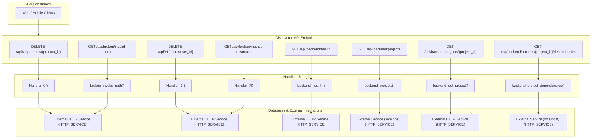

# Dependency Guardian — Repository Integration Map

Visual relationship map and matrix linking endpoints, handlers, internal dependencies, databases, and external third-party services.

## 1. System Architecture and Integration Diagram

---

## 2. End-to-End Relationship Matrix

| Route & Method | Handler Function | Source Location | Direct Dependencies | Storage / External Targets | Side Effects |
|---|---|---|---|---|---|
| `DELETE /api/v1/products/{product_id}` | *N/A* | `contracts/openapi-v1.json:None` | *None* | *In-memory / Read-only* | None detected |
| `DELETE /api/v1/users/{user_id}` | *N/A* | `contracts/openapi-v1.json:None` | *None* | *In-memory / Read-only* | None detected |
| `GET /api/backend/health` | `backend_health()` | `main.py:61` | httpx | *In-memory / Read-only* | None detected |
| `GET /api/backend/projects` | `backend_projects()` | `main.py:89` | httpx | *In-memory / Read-only* | None detected |
| `GET /api/backend/projects/{project_id}` | `backend_get_project()` | `main.py:136` | httpx | *In-memory / Read-only* | None detected |
| `GET /api/backend/projects/{project_id}/dependencies` | `backend_project_dependencies()` | `main.py:162` | httpx | *In-memory / Read-only* | None detected |
| `GET /api/broken/invalid-path` | `broken_invalid_path()` | `main.py:187` | *None* | *In-memory / Read-only* | None detected |
| `GET /api/broken/method-mismatch` | *N/A* | `openapi.json:None` | *None* | *In-memory / Read-only* | None detected |
| `GET /api/v1/orders` | *N/A* | `contracts/openapi-v1.json:None` | *None* | *In-memory / Read-only* | None detected |
| `GET /api/v1/orders/{order_id}` | *N/A* | `contracts/openapi-v1.json:None` | *None* | *In-memory / Read-only* | None detected |
| `GET /api/v1/payments/{payment_id}` | *N/A* | `contracts/openapi-v1.json:None` | *None* | *In-memory / Read-only* | None detected |
| `GET /api/v1/payments/{payment_id}/receipt` | *N/A* | `contracts/openapi-v1.json:None` | *None* | *In-memory / Read-only* | None detected |
| `GET /api/v1/products` | *N/A* | `contracts/openapi-v1.json:None` | *None* | *In-memory / Read-only* | None detected |
| `GET /api/v1/products/{product_id}` | *N/A* | `contracts/openapi-v1.json:None` | *None* | *In-memory / Read-only* | None detected |
| `GET /api/v1/users` | *N/A* | `contracts/openapi-v1.json:None` | *None* | *In-memory / Read-only* | None detected |
| `GET /api/v1/users/{user_id}` | *N/A* | `contracts/openapi-v1.json:None` | *None* | *In-memory / Read-only* | None detected |
| `GET /health` | `self_health()` | `main.py:49` | *None* | *In-memory / Read-only* | None detected |
| `PATCH /api/v1/orders/{order_id}/status` | *N/A* | `contracts/openapi-v1.json:None` | *None* | *In-memory / Read-only* | None detected |
| `POST /api/backend/projects` | `backend_create_project()` | `main.py:111` | httpx | *In-memory / Read-only* | None detected |
| `POST /api/broken/method-mismatch` | `broken_method_mismatch()` | `main.py:208` | *None* | *In-memory / Read-only* | None detected |
| `POST /api/broken/payload-mismatch` | `broken_payload_mismatch()` | `main.py:230` | *None* | *In-memory / Read-only* | None detected |
| `POST /api/v1/orders` | *N/A* | `contracts/openapi-v1.json:None` | *None* | *In-memory / Read-only* | None detected |
| `POST /api/v1/payments` | *N/A* | `contracts/openapi-v1.json:None` | *None* | *In-memory / Read-only* | None detected |
| `POST /api/v1/products` | *N/A* | `contracts/openapi-v1.json:None` | *None* | *In-memory / Read-only* | None detected |
| `POST /api/v1/users` | *N/A* | `contracts/openapi-v1.json:None` | *None* | *In-memory / Read-only* | None detected |
| `PUT /api/v1/products/{product_id}` | *N/A* | `contracts/openapi-v1.json:None` | *None* | *In-memory / Read-only* | None detected |
| `PUT /api/v1/users/{user_id}` | *N/A* | `contracts/openapi-v1.json:None` | *None* | *In-memory / Read-only* | None detected |

---

## 3. Outbound Network Boundaries

> [!IMPORTANT]
> All external outbound connections originating from this repository are inventoried below.

| Integration Name | Target Endpoint / Host | Integration Type | Initiating Source File | Redacted Credentials |
|---|---|---|---|:---:|
| **External HTTP Service** | `{var}/api/v1/nonexistent-service` | `http_service` | `client.py:113` | 0 (Safe) |
| **External HTTP Service** | `{var}/api/v1/health` | `http_service` | `client.py:124` | 0 (Safe) |
| **External HTTP Service** | `{var}/api/v1/projects` | `http_service` | `client.py:136` | 0 (Safe) |
| **External Service (localhost)** | `http://localhost:8000/api/v1/health` | `http_service` | `client.py:38` | 0 (Safe) |
| **External HTTP Service** | `{var}/api/v1/health` | `http_service` | `client.py:40` | 0 (Safe) |
| **External Service (localhost)** | `http://localhost:8000/api/v1/projects` | `http_service` | `client.py:51` | 0 (Safe) |
| **External HTTP Service** | `{var}/api/v1/projects` | `http_service` | `client.py:53` | 0 (Safe) |
| **External Service (localhost)** | `http://localhost:8000/api/v1/projects` | `http_service` | `client.py:69` | 0 (Safe) |
| **External HTTP Service** | `{var}/api/v1/projects` | `http_service` | `client.py:71` | 0 (Safe) |
| **External Service (localhost)** | `http://localhost:8000/api/v1/projects/{project_id}` | `http_service` | `client.py:82` | 0 (Safe) |
| **External HTTP Service** | `{var}/api/v1/projects/{project_id}` | `http_service` | `client.py:84` | 0 (Safe) |
| **External Service (localhost)** | `http://localhost:8000/api/v1/projects/{project_id}/dependencies` | `http_service` | `client.py:95` | 0 (Safe) |
| **External HTTP Service** | `{var}/api/v1/projects/{project_id}/dependencies` | `http_service` | `client.py:97` | 0 (Safe) |
| **External Service (localhost)** | `http://localhost:8000/api/v1/nonexistent-service` | `http_service` | `client.py:112` | 0 (Safe) |
| **External Service (localhost)** | `http://localhost:8000/api/v1/health` | `http_service` | `client.py:123` | 0 (Safe) |
| **External Service (localhost)** | `http://localhost:8000/api/v1/projects` | `http_service` | `client.py:135` | 0 (Safe) |
