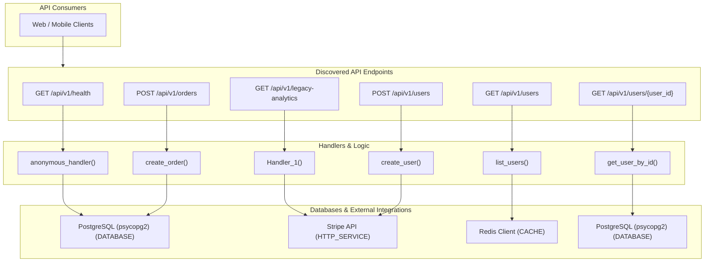

# Dependency Guardian — Repository Integration Map

Visual relationship map and matrix linking endpoints, handlers, internal dependencies, databases, and external third-party services.

## 1. System Architecture and Integration Diagram

---

## 2. End-to-End Relationship Matrix

| Route & Method | Handler Function | Source Location | Direct Dependencies | Storage / External Targets | Side Effects |
|---|---|---|---|---|---|
| `GET /api/v1/health` | `anonymous_handler()` | `web/server.js:11` | *None* | *In-memory / Read-only* | None detected |
| `GET /api/v1/legacy-analytics` | *N/A* | `openapi.json:None` | *None* | *In-memory / Read-only* | None detected |
| `GET /api/v1/users` | `list_users()` | `app/main.py:45` | *None* | *In-memory / Read-only* | None detected |
| `GET /api/v1/users/{user_id}` | `get_user_by_id()` | `app/main.py:88` | *None* | *In-memory / Read-only* | None detected |
| `POST /api/v1/orders` | `create_order()` | `app/main.py:103` | *None* | Database | database_write, database_write |
| `POST /api/v1/users` | `create_user()` | `app/main.py:54` | httpx, redis | Message Queue, External Service, Database | database_write, database_write, external_http, message_publish |

---

## 3. Outbound Network Boundaries

> [!IMPORTANT]
> All external outbound connections originating from this repository are inventoried below.

| Integration Name | Target Endpoint / Host | Integration Type | Initiating Source File | Redacted Credentials |
|---|---|---|---|:---:|
| **PostgreSQL (psycopg2)** | *Configured Host* | `database` | `app/main.py:63` | 0 (Safe) |
| **Stripe API** | `https://api.stripe.com/v1/customers` | `http_service` | `app/main.py:69` | 0 (Safe) |
| **Redis Client** | *Configured Host* | `cache` | `app/main.py:76` | 0 (Safe) |
| **PostgreSQL (psycopg2)** | *Configured Host* | `database` | `app/main.py:107` | 0 (Safe) |
