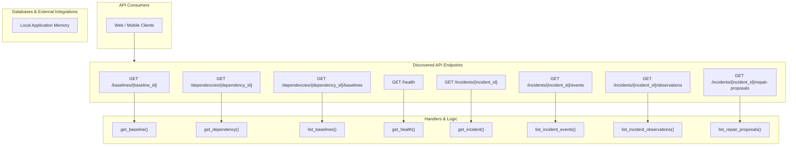

# Dependency Guardian — Repository Integration Map

Visual relationship map and matrix linking endpoints, handlers, internal dependencies, databases, and external third-party services.

## 1. System Architecture and Integration Diagram

---

## 2. End-to-End Relationship Matrix

| Route & Method | Handler Function | Source Location | Direct Dependencies | Storage / External Targets | Side Effects |
|---|---|---|---|---|---|
| `GET /baselines/{baseline_id}` | `get_baseline()` | `app/routers/baselines.py:158` | db | *In-memory / Read-only* | None detected |
| `GET /dependencies/{dependency_id}` | `get_dependency()` | `app/routers/dependencies.py:30` | db | *In-memory / Read-only* | None detected |
| `GET /dependencies/{dependency_id}/baselines` | `list_baselines()` | `app/routers/baselines.py:116` | db | *In-memory / Read-only* | None detected |
| `GET /health` | `get_health()` | `app/routers/health.py:8` | *None* | *In-memory / Read-only* | None detected |
| `GET /incidents/{incident_id}` | `get_incident()` | `app/routers/incidents.py:56` | db | *In-memory / Read-only* | None detected |
| `GET /incidents/{incident_id}/events` | `list_incident_events()` | `app/routers/incidents.py:109` | db | *In-memory / Read-only* | None detected |
| `GET /incidents/{incident_id}/observations` | `list_incident_observations()` | `app/routers/incidents.py:116` | db | *In-memory / Read-only* | None detected |
| `GET /incidents/{incident_id}/repair-proposals` | `list_repair_proposals()` | `app/routers/incidents.py:125` | db | *In-memory / Read-only* | None detected |
| `GET /incidents/{incident_id}/repairs` | `list_repair_proposals()` | `app/routers/incidents.py:125` | db | *In-memory / Read-only* | None detected |
| `GET /projects` | `list_projects()` | `app/routers/projects.py:21` | db | *In-memory / Read-only* | None detected |
| `GET /projects/{project_id}` | `get_project()` | `app/routers/projects.py:44` | db | *In-memory / Read-only* | None detected |
| `GET /projects/{project_id}/activity` | `list_activity()` | `app/routers/projects.py:65` | db | *In-memory / Read-only* | None detected |
| `GET /projects/{project_id}/baselines` | `list_project_baselines()` | `app/routers/baselines.py:27` | db | *In-memory / Read-only* | None detected |
| `GET /projects/{project_id}/baselines/active` | `get_active_project_baseline()` | `app/routers/baselines.py:57` | db | *In-memory / Read-only* | None detected |
| `GET /projects/{project_id}/baselines/compare` | `compare_project_baselines()` | `app/routers/baselines.py:70` | db | *In-memory / Read-only* | None detected |
| `GET /projects/{project_id}/baselines/{baseline_id}` | `get_project_baseline()` | `app/routers/baselines.py:85` | db | *In-memory / Read-only* | None detected |
| `GET /projects/{project_id}/dependencies` | `list_dependencies()` | `app/routers/dependencies.py:16` | db | *In-memory / Read-only* | None detected |
| `GET /projects/{project_id}/incidents` | `list_incidents()` | `app/routers/incidents.py:22` | db | *In-memory / Read-only* | None detected |
| `GET /projects/{project_id}/members` | `list_members()` | `app/routers/projects.py:51` | db | *In-memory / Read-only* | None detected |
| `GET /projects/{project_id}/scans` | `list_scans()` | `app/routers/scans.py:22` | db | *In-memory / Read-only* | None detected |
| `GET /projects/{project_id}/summary` | `get_project_summary()` | `app/routers/projects.py:82` | db | *In-memory / Read-only* | None detected |
| `GET /repair-proposals/{repair_id}` | `get_repair_proposal()` | `app/routers/repairs.py:23` | db | *In-memory / Read-only* | None detected |
| `GET /repair-proposals/{repair_id}/validation-runs` | `list_validation_runs()` | `app/routers/repairs.py:31` | db | *In-memory / Read-only* | None detected |
| `GET /repairs/{repair_id}` | `get_repair_proposal()` | `app/routers/repairs.py:23` | db | *In-memory / Read-only* | None detected |
| `GET /repairs/{repair_id}/validation-runs` | `list_validation_runs()` | `app/routers/repairs.py:31` | db | *In-memory / Read-only* | None detected |
| `GET /scans/{scan_id}` | `get_scan()` | `app/routers/scans.py:59` | db | *In-memory / Read-only* | None detected |
| `PATCH /dependencies/{dependency_id}` | `update_dependency()` | `app/routers/dependencies.py:37` | db | *In-memory / Read-only* | None detected |
| `PATCH /incidents/{incident_id}` | `update_incident()` | `app/routers/incidents.py:63` | db | *In-memory / Read-only* | None detected |
| `POST /dependencies/{dependency_id}/baselines` | `create_baseline()` | `app/routers/baselines.py:139` | db | *In-memory / Read-only* | None detected |
| `POST /incidents/{incident_id}/acknowledge` | `acknowledge_incident()` | `app/routers/incidents.py:70` | db | *In-memory / Read-only* | None detected |
| `POST /incidents/{incident_id}/reopen` | `reopen_incident()` | `app/routers/incidents.py:96` | db | *In-memory / Read-only* | None detected |
| `POST /incidents/{incident_id}/repair-proposals` | `create_repair_proposal()` | `app/routers/incidents.py:133` | db | *In-memory / Read-only* | None detected |
| `POST /incidents/{incident_id}/repairs` | `create_repair_proposal()` | `app/routers/incidents.py:133` | db | *In-memory / Read-only* | None detected |
| `POST /incidents/{incident_id}/resolve` | `resolve_incident()` | `app/routers/incidents.py:83` | db | *In-memory / Read-only* | None detected |
| `POST /projects` | `create_project()` | `app/routers/projects.py:37` | db | *In-memory / Read-only* | None detected |
| `POST /projects/{project_id}/baselines` | `create_project_baseline()` | `app/routers/baselines.py:44` | db | *In-memory / Read-only* | None detected |
| `POST /projects/{project_id}/baselines/{baseline_id}/promote` | `promote_project_baseline()` | `app/routers/baselines.py:96` | db | *In-memory / Read-only* | None detected |
| `POST /projects/{project_id}/dependencies` | `create_dependency()` | `app/routers/dependencies.py:23` | db | *In-memory / Read-only* | None detected |
| `POST /projects/{project_id}/incidents` | `create_incident()` | `app/routers/incidents.py:49` | db | *In-memory / Read-only* | None detected |
| `POST /projects/{project_id}/members` | `add_member()` | `app/routers/projects.py:58` | db | Database | database_write |
| `POST /projects/{project_id}/scans` | `start_scan()` | `app/routers/scans.py:38` | db | *In-memory / Read-only* | None detected |
| `POST /projects/{project_id}/scans/ingest` | `ingest_scan()` | `app/routers/scans.py:50` | db | *In-memory / Read-only* | None detected |
| `POST /repair-proposals/{repair_id}/applications` | `record_repair_application()` | `app/routers/repairs.py:62` | db | *In-memory / Read-only* | None detected |
| `POST /repair-proposals/{repair_id}/approvals` | `approve_repair()` | `app/routers/repairs.py:47` | db | *In-memory / Read-only* | None detected |
| `POST /repair-proposals/{repair_id}/rejection` | `reject_repair()` | `app/routers/repairs.py:54` | db | *In-memory / Read-only* | None detected |
| `POST /repair-proposals/{repair_id}/validation-runs` | `create_validation_run()` | `app/routers/repairs.py:39` | db | *In-memory / Read-only* | None detected |
| `POST /repairs/{repair_id}/apply-result` | `record_repair_application()` | `app/routers/repairs.py:62` | db | *In-memory / Read-only* | None detected |
| `POST /repairs/{repair_id}/approve` | `approve_repair()` | `app/routers/repairs.py:47` | db | *In-memory / Read-only* | None detected |
| `POST /repairs/{repair_id}/validate` | `create_validation_run()` | `app/routers/repairs.py:39` | db | *In-memory / Read-only* | None detected |
| `POST /scans/{scan_id}/complete` | `complete_scan()` | `app/routers/scans.py:85` | db | *In-memory / Read-only* | None detected |
| `POST /scans/{scan_id}/observations` | `submit_observations()` | `app/routers/scans.py:72` | db | *In-memory / Read-only* | None detected |

---

## 3. Outbound Network Boundaries

> [!IMPORTANT]
> All external outbound connections originating from this repository are inventoried below.

| Integration Name | Target Endpoint / Host | Integration Type | Initiating Source File | Redacted Credentials |
|---|---|---|---|:---:|
